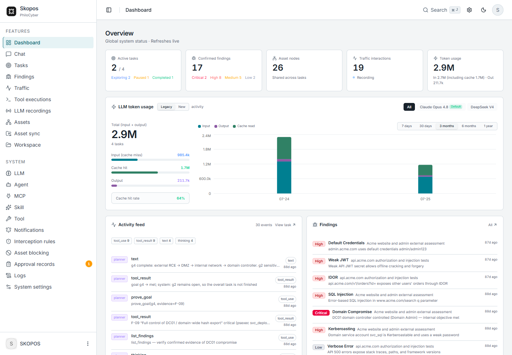
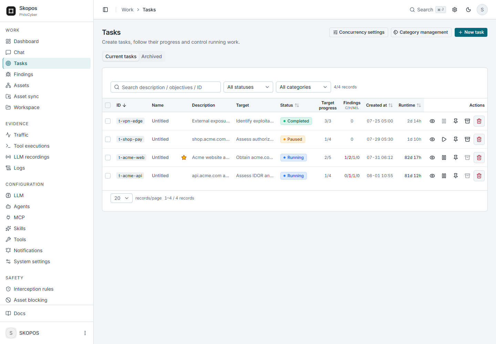
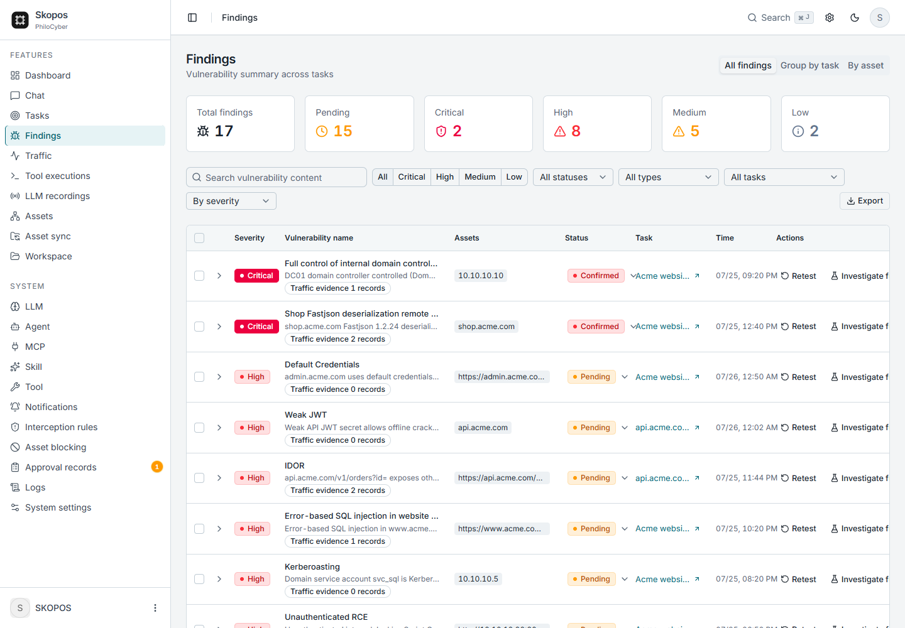
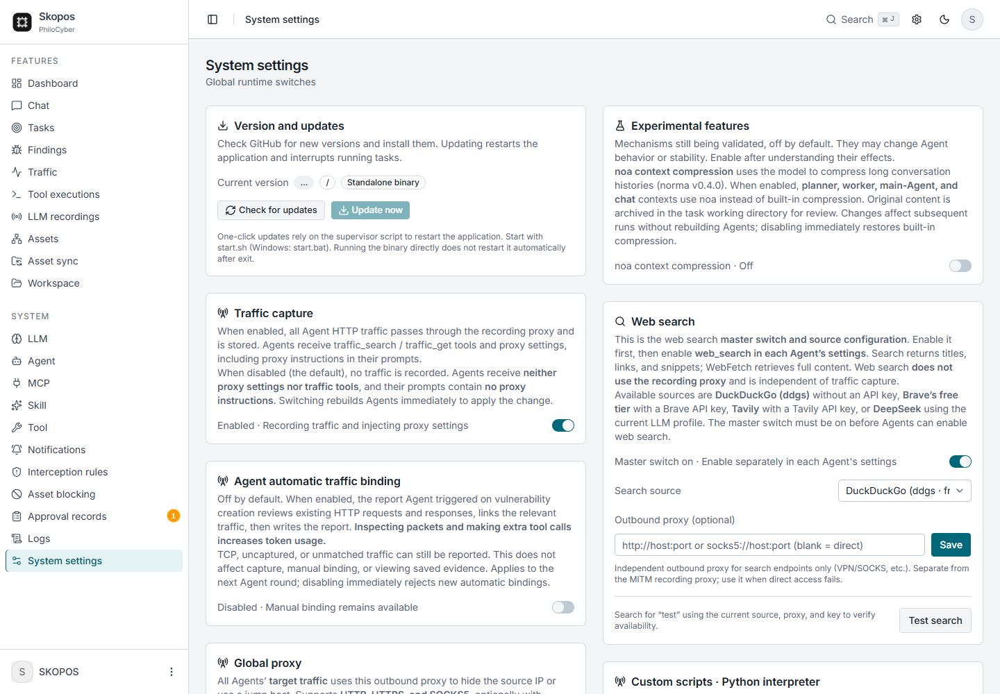
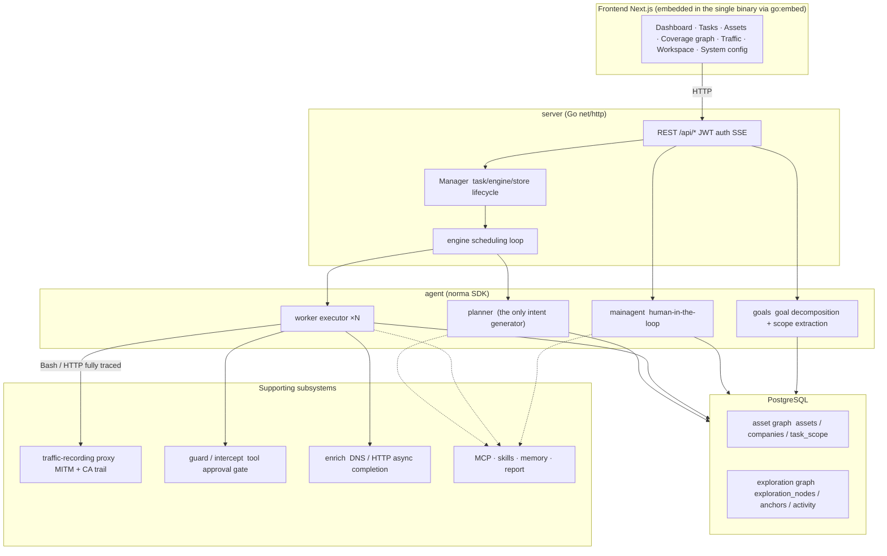
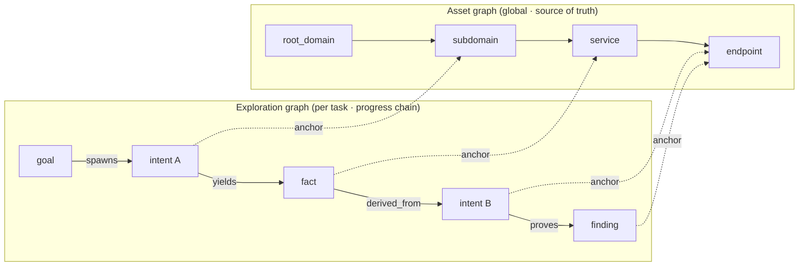
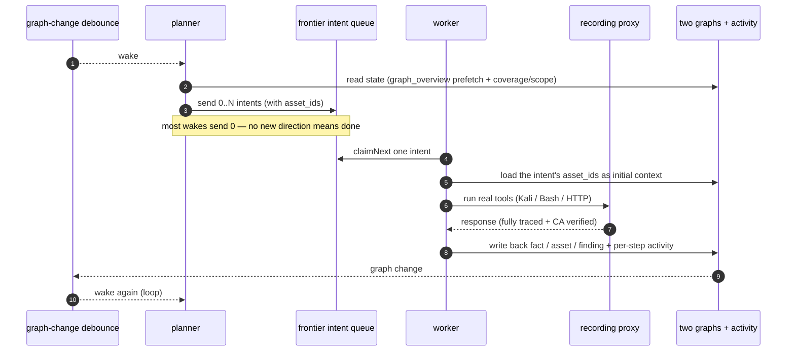
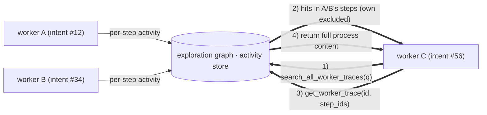
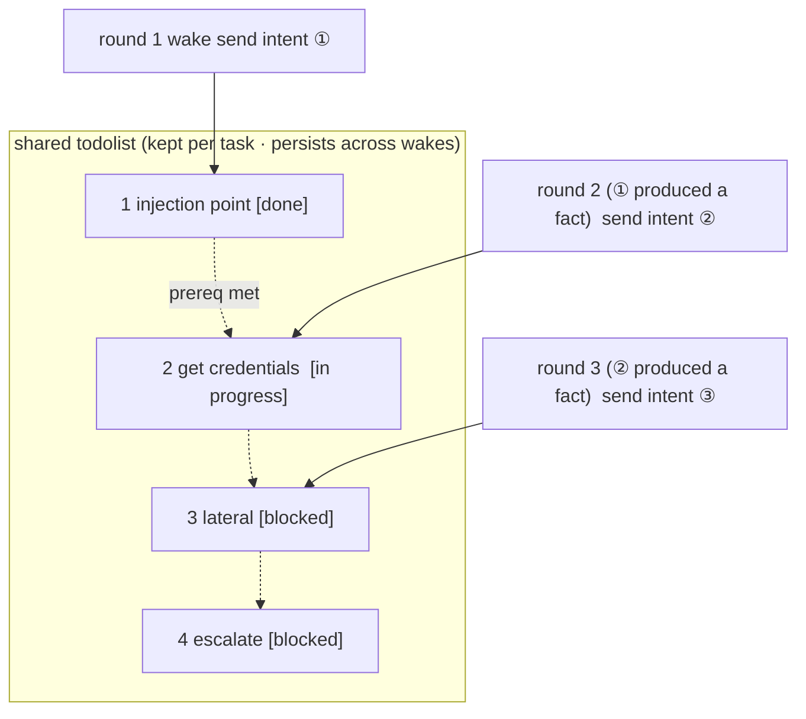

<div align="center">

# Skopos

**An LLM multi-agent autonomous penetration-testing platform** — plan, execute, and report a
security engagement end to end, with full HTTP evidence behind every finding.

Go backend · Next.js frontend · PostgreSQL · AGPL-3.0

</div>

---

## What Skopos does

- **Multi-agent exploration engine.** A planner and N parallel workers share a two-graph model
  (asset graph + exploration graph) to build and track a stable, multi-step attack chain across
  sessions, instead of a one-shot script that forgets what it already tried.
- **Evidence-backed findings.** Every HTTP request/response the agents make is captured through a
  MITM recording proxy and bound to the findings it supports — reports are defensible, not just
  narrated.
- **Bring your own LLM.** Anthropic Claude, OpenAI (Chat Completions or Responses API), Z.ai GLM,
  Vercel AI Gateway or Amazon Bedrock API keys (one key for Claude, DeepSeek, Qwen, GLM and more),
  or any OpenAI-compatible endpoint, configured per agent with ready-made presets.
- **Human-in-the-loop safety.** A shell/command interception gate requires approval for risky
  executions by default, with fine-grained allow/deny rules once you trust a workflow.
- **One-click vulnerability retest.** Re-verify a finding later with a dedicated retest agent that
  reports Reproduced / Fixed / Inconclusive against the original evidence.
- **Extensible by design.** A bundled `agentskills.io`-format skill library (60+ vulnerability-class
  and methodology skills), custom tools (shell/command/script/HTTP), MCP servers, and direct asset
  sync from [ScopeSentry](https://github.com/Autumn-27/ScopeSentry).
- **Deploy in minutes.** A single Go binary with the frontend embedded, a one-click install script,
  or Docker Compose — with in-app one-click updates once you're running.

> **Authorization required.** This is a security-testing tool. Use it only against systems you own
> or are explicitly authorized to test. See [Permitted use](#permitted-use) and
> [Prohibited](#prohibited) below — these are binding terms, not a suggestion.

---

> **About this project.** Skopos is derived from [Autumn-27/ARTEX](https://github.com/Autumn-27/ARTEX)
> at upstream commit `160fe13`, rebranded and translated into English. See
> [Provenance and changes](#provenance-and-changes) for exactly what differs from upstream, and
> [License and disclaimer](#license-and-disclaimer) for the terms, which are unchanged (AGPL-3.0).

Modification date: **2026-10-02**. See [provenance and changes](docs/PROVENANCE.md); this is not a release tag.

[Verification status and known limitations](docs/VERIFICATION.md).

---

## Language

English is the only supported interface and documentation language. The
[full documentation](docs/README.md) includes the bundled skill guidance.

## Screenshots

These captures show Skopos's English interface with the included fictional demo data.
They do not represent scans of live targets. See the [mobile view](screenshots/en/mobile.png).

| Dashboard | Tasks |
| :---: | :---: |
|  |  |
| Findings | Settings |
|  |  |

Original Chinese screenshots remain in [the screenshots directory](screenshots), credited to
[upstream ARTEX](https://github.com/Autumn-27/ARTEX/tree/160fe13c243be361eeac5408c40a96e824fa842c/screenshots).

---

## Approval records

The global "Approval records" view, the in-task "Interception approval" panel, and the approval
cards shown inside conversations all expand to show full detail. The presentation follows the
[approval-detail component from AegisHook](https://github.com/RuoJi6/AegisHook/blob/main/web/src/components/CallDetail.vue),
reusing the upstream component and theme.

When shell interception and any restrictive tool-input rule are enabled, every
unmatched Bash/shell_open/shell_send execution requires human approval. This
includes literal commands, native programs, scripts and empty interactive input:
input parsing does not confine their filesystem or network effects. The model
judge cannot authorize this fallback; cancellation or the five-minute timeout
denies it even if the judge's timeout policy allows execution. Matching operator
allow/deny rules retain priority, and disabling the selected tool's interception
remains an explicit operator choice. Repeated authorized research workflows can
use narrowly scoped operator allow rules. The syntax descriptions below concern
parsed data/code roles, rather than permission to execute automatically.

When shell interception and a restrictive tool-input rule are enabled, a command
that selects its executable through a variable or command substitution requires
human approval. This applies even when the fallback judge is disabled or would
allow it; cancellation and the five-minute approval timeout block execution.
Explicit matching allow rules retain their priority. Disabling interception
retains the operator's unrestricted behavior. This approval gate does not
provide an OS sandbox or inspect every generated program or external script.
The same human approval applies to curl/wget request methods that depend on
runtime option arguments, argument splitting/globbing, or explicit configuration
files (curl `-K`/`--config`, wget `--config`/`-e`/`--execute`). Quoted scalar
header/body values retain their data role. Default startup configuration also
requires approval unless explicitly disabled: use curl `-q` or `--disable` as
the first argument, or wget `--no-config` as an option. These flags do not exempt
explicit configuration or runtime method arguments from review. Windows
`curl.exe`/`wget.exe` names and explicit Windows paths receive the same HTTP
checks. Curl variable-expanded method/config options (`--expand-request` and
`--expand-config`) and prefixes of sensitive curl/wget long options also
require review, even when default configuration is disabled. Their presence
inside header/body data does not make that data a method selector.
Unsupported executors, shell state and runtime network enforcement
still need separate controls.
For bash/sh/dash/ksh, generated `-c` programs, external script files, unknown
stdin programs and unresolved invocation options also require human approval.
Literal programs remain inspectable, and known noninteractive syntax-check
modes retain their data behavior. Script files are not opened during review.
Literal `eval` arguments are joined and inspected as shell code. Generated
`eval` arguments and files loaded through `source`/`.` require human approval,
including supported `command`/`builtin` forms. Empty programs and printed text
retain their ordinary behavior. Literal trap actions are inspected as deferred
shell programs; generated actions require approval. Alias definitions are
inspected and also require approval when no earlier rule decides them, because
replacement fragments can combine with later arguments and shell state. Trap
listing/reset and alias listing/query forms remain data operations. Supported
`builtin trap` and `builtin alias` follow the same checks; persistent session
state is not reconstructed or sandboxed.
Incomplete or unsupported shell syntax also requires human approval when a
restrictive input rule is enabled, including uninspectable nested programs.
Quoted text, empty input and known noninteractive syntax-check programs remain
data; an explicit matching allow rule can still authorize execution.

## Asset sync (ScopeSentry)

You can sync asset data directly from [ScopeSentry](https://github.com/Autumn-27/ScopeSentry),
which saves you from collecting the same data twice:

- On the **Asset sync** page, enter your ScopeSentry address and API key to connect the data source.
- Choose what to sync by **project** or by **task**, and pick the asset types (domain / subdomain /
  IP / port / site / endpoint …).
- Import in one click. Assets are merged into the company asset scope and go straight into the
  asset graph for agents to explore.

---

## Installation

### GLM and other model providers

The **LLM → New** form includes GLM-5.3 configuration templates for Z.ai's General API and a
separately labeled Coding Plan reference. Add your own API key; template selection does not save,
activate, or contact a provider. Coding Plan use is restricted to officially supported tools, and
Skopos is not listed. See [provider setup and support limits](docs/llm-providers.md).

No direct provider key? **LLM → New → Gateways** has templates for the Vercel AI Gateway and Amazon
Bedrock API keys, which reach many models with one key. The form flags wrong URLs and model IDs
before you test, and failed tests explain the likely cause. See
[gateways](docs/llm-providers.md#gateways-one-key-many-models).

> Requires a **PostgreSQL** database. Exploration needs an **LLM** configured
> (`ANTHROPIC_API_KEY` or `OPENAI_API_KEY`, or set it in the UI).

### Option 1: one-click install script (recommended)

```bash
git clone https://github.com/Philocyber/skopos.git
cd skopos
./install.sh
```

The script detects (and optionally installs) Docker, then lets you choose **① all-in-Docker** or
**② build and run locally**:

- **① All-in-Docker**: first provide a trusted management certificate/key in `tls/server.pem` and `tls/server-key.pem`, then enter one Postgres password (press Enter for a random one) → it writes
  `.env` → `docker compose up -d`.
- **② Local**: pick a database (connect to an existing one, or start one with Docker) → it
  generates `config.json` → `go` compiles a single binary with the frontend embedded → start.

Once it is up, open **https://localhost:8787** for Docker, or **http://localhost:8787** for the local default (the first visit lands on `/setup` to set the admin password).

First-owner setup requires a token from the backend machine. After starting the backend,
run its executable with `-setup-token` (for example `./skopos -setup-token`, or
`.\skopos.exe -setup-token` on Windows). With Docker, run
`docker compose exec skopos /app/skopos -setup-token`.
Paste that token into the setup page with your new password. The command reads the existing
local signing key without starting another server or contacting PostgreSQL. Treat the token
as a secret. Existing installations with a password continue to use normal login.

Sessions are bound to the current password generation. Changing the password or using
`reset-password.sh` invalidates earlier tokens on their next authenticated request, without
restarting the backend. A web password change refreshes the current browser's token; other
sessions must sign in again. After updating from a version without credential-bound sessions,
existing sessions also need to sign in again. Requests already admitted, including open
streams, are not cancelled by a password change.

Local recovery uses the current backend binary: `./reset-password.sh -m local --backend ./skopos` (Windows: `--backend ./skopos.exe`). It reads the existing DSN/configuration and prompts for the new password. The helper passes connection/password values through environment variables and invokes only `-reset-password`; local recovery no longer requires psql or pgcrypto. The binary can also be invoked directly with `-reset-password`, using `SKOPOS_RESET_NEWPASS` and normal database configuration. New passwords must contain 1–72 bytes. Docker recovery keeps its existing psql workflow. Use environment/config input for credentials; explicit secret CLI flags remain visible in the caller's own argv. Environment variables are not a boundary against the same OS account or administrators. Use a current binary; an older build without the flag fails without resetting the password.

API authentication requires `Authorization: Bearer <token>` or an explicit `?token=`
for EventSource streams. Cookies never authorize API requests. The web UI keeps its
JWT in origin-scoped localStorage and uses only a non-secret `skopos_session=1` cookie
for page redirects. Older JWT cookies are cleared when visiting the app; existing
localStorage sessions continue through the login page. API clients using cookie-only
authentication must switch to the Bearer header.

### Option 2: Docker Compose (manual)

```bash
git clone https://github.com/Philocyber/skopos.git
cd skopos
install -m 600 .env.example .env  # Unix: set POSTGRES_PASSWORD, optionally ANTHROPIC_API_KEY
# Place a trusted certificate and matching key in tls/server.pem and tls/server-key.pem.
docker compose up -d --build  # builds the skopos image locally + postgres
# → https://localhost:8787
```

On Windows, prepare `.env` with Windows PowerShell before editing credentials:
`powershell.exe -NoProfile -File .\private-credential.ps1 -Path .\.env -Template .\.env.example`.
This creates the file with a private ACL; an existing file is protected and its contents preserved.

> The default compose file **builds the image locally** from this source. To use a published
> release image from `ghcr.io/philocyber/skopos`, explicitly select its version in compose.

The image bundles common tools (ripgrep/curl/vim/npm/nmap…); `./skills` and `./data` are
bind-mounted so they persist.

Compose publishes management HTTPS on `127.0.0.1:8787` and mounts `./tls` read-only. Supply `tls/server.pem` (certificate chain) and `tls/server-key.pem` (matching private key), valid for the browser hostname and trusted by your clients. Keep the key private; `tls/` is excluded from Git and image builds. Existing Docker installs must provide these files before restarting the upgraded container and switch to HTTPS; log in again because HTTP and HTTPS have separate browser storage. Missing/invalid certificates fail startup. The installer checks for the files before building or starting Docker. Remote publication also uses native TLS; an HTTPS reverse proxy must verify the backend certificate. Host loopback publication remains the default, and the recording-proxy exposure is a separate control.

A remote MCP can use `http` (Streamable HTTP) or `sse` (legacy SSE) in system settings. Legacy SSE
servers usually open the event stream with `GET /sse` and then receive JSON-RPC requests on the
`/message?sessionId=...` the server returns; set the URL to `/sse` and the header to
`Authorization=Bearer <token>`.

Remote MCP redirects and legacy SSE message endpoints must remain on the configured
URL's scheme, hostname and effective port. Relative endpoints and same-origin
normalization redirects work normally. Put credentials in configured headers rather
than URL user info. A server with its message endpoint on another origin needs to
expose that endpoint through the configured origin.

Remote MCP responses have an 8 MiB byte budget. Streamable HTTP limits the JSON
body or cumulative SSE bytes read before the matching response; legacy SSE limits
each response line. Endpoint announcements have a 64 KiB setup budget. Oversized
responses fail explicitly rather than returning truncated evidence. Legacy setup
follows caller cancellation and has a 120-second maximum; successful streams remain
open until the client is closed or the remote stream ends.

### Option 3: download a prebuilt binary (Releases)

> Download a platform archive from [Releases](https://github.com/Philocyber/skopos/releases).
> The archive for each platform is
> `skopos-<version>-<os>-<arch>.zip`, unpacking to `skopos` + `start.sh`
> (`start.bat` on Windows) + `skills/` + `config.example.json`:

The archive also includes `adapters/agent/`; see the [agent setup instructions](adapters/agent/README.md).

```bash
install -m 600 config.example.json config.json  # Unix: fill in the database connection
./start.sh                            # → http://localhost:8787
```

On Windows, use the included helper before editing `config.json`, then run `start.bat`:
`powershell.exe -NoProfile -File .\private-credential.ps1 -Path .\config.json -Template .\config.example.json`.
New credentials are private from creation; existing configuration bytes are preserved.

> Start with `start.sh` / `start.bat`, not `./skopos` directly. It is a supervisor: after the
> program exits it decides, from the exit code, whether to relaunch, and the
> [in-app one-click update](#option-1-in-app-one-click-update-recommended) relies on it to swap in
> the new build. Running `./skopos` directly means an update will not be relaunched.
> To run in the background: `nohup ./start.sh >skopos.log 2>&1 &`.

### Option 4: build a single binary from source

```bash
# 1) export the frontend as static files
cd web && npm ci && npm run build:static && cd ..
# 2) copy it into the embed directory
mkdir -p server/webui/dist
cp -R web/out/. server/webui/dist/
# 3) build (the embedui tag embeds the frontend)
CGO_ENABLED=0 go build -tags embedui -o skopos ./cmd/skopos
./start.sh
```

### Option 5: build cross-platform release archives

`build.sh` builds and embeds the frontend, strips debug info with the Go linker, and zips each
release. Release mode builds Linux amd64/arm64, macOS amd64/arm64, and Windows amd64 by default:

```bash
./build.sh --release
# output: dist/skopos-0.3.3-*.zip
```

UPX-packed self-extracting binaries can clash with some Linux kernels, virtualization, or security
policies, so UPX is off by default. Set custom targets with `SKOPOS_TARGETS`, and pass `--upx` explicitly when you have confirmed the target is compatible:

```bash
SKOPOS_TARGETS=linux/amd64,windows/amd64 ./build.sh --release
./build.sh --target linux/amd64 --upx
```

---

## Updating

> Updates swap the program only; your data stays put. The Postgres volume `pgdata`, `./data`
> (jwt.key / SQLite / …), and `./skills` are all preserved. **Database migrations run on their
> own** — `skopos` re-runs `schema.sql` idempotently on every start (including `ADD COLUMN` /
> `CREATE INDEX IF NOT EXISTS`), so "restart is migrate." Still, back up `./data` and the database
> before upgrading.

### Option 1: in-app one-click update (recommended)

On the **System configuration** page (sidebar "System configuration" → `/system/settings`), the
**Version and updates** card checks for and installs new versions without logging into the server.

After you click "Update": it downloads the release for your platform → checks it against the
release's `SHA256SUMS` → smoke-tests the new binary with `-h` → stages it as `skopos.new` →
the program exits and `start.sh` / `start.bat` relaunches it to finish the swap. The page waits for
the new version to come up and refreshes.

- **A failed update leaves no broken program**: if verification or the smoke test fails, the staged
  file is discarded and the current version keeps running. If a swapped-in version fails to start
  three times in a row, it rolls back to `skopos.old` automatically (the failed one is kept as
  `skopos.failed` for inspection).
- **Roll back anytime**: the previous version is kept as `skopos.old`, and the card has a
  "Roll back to previous version" button. Note that the database schema does not roll back.
- **Updating interrupts running tasks** — an update is a restart, so do it when idle.
- **Development builds get no updates**: this is disabled when the version is `dev` or a
  `git describe` string with a suffix, so a release does not overwrite a locally built debug binary.
- **Under Docker, only the program changes, not the image**: the playwright / nmap toolchains in the
  image do not upgrade along with it, and rebuilding the container with `docker compose up -d` reverts
  to the versions baked into the image. To upgrade the image too, use
  `docker compose pull skopos && docker compose up -d skopos` (once a published image exists;
  otherwise `docker compose up -d --build skopos`).
- If reaching GitHub needs a proxy, configure the **global proxy** on the same page and the update
  path uses it. Updates download only from GitHub domains and force HTTPS.

### Option 2: one-click update script

```bash
cd skopos
./update.sh
```

The script optionally runs `git pull` first, then lets you choose **① Docker update** or
**② local build update** (matching `install.sh`):

- **① Docker**: rebuild the current checkout with `docker compose build skopos`, then
  recreate the service with `docker compose up -d skopos`.
- **② Local**: rebuild the frontend static output → recompile `./skopos` (restart the process
  to apply).

### Option 3: Docker Compose (manual)

```bash
cd skopos
git pull                       # update compose / scripts (optional)
# To pin a source version, check out a reviewed tag or commit before building.
docker compose up -d --build skopos   # rebuild from source and restart → auto-migrate schema
docker image prune -f          # clean up old images (optional)
```

> Once a published image exists and compose explicitly selects it, replace the build step with
> `docker compose pull skopos && docker compose up -d skopos`.

### Option 4: prebuilt binary (Releases)

Download the new `skopos-<version>-<os>-<arch>.zip`, stop the old process,
overwrite `skopos` and `skills/` (keep your `config.json` and `data/`), and restart:

```bash
cp -r <unpacked>/skills ./ && cp <unpacked>/skopos ./
./start.sh
```

### Option 5: build from source

```bash
git pull
cd web && npm ci && npm run build:static && cd ..
cp -r web/out server/webui/dist
CGO_ENABLED=0 go build -tags embedui -o skopos ./cmd/skopos
# restart ./start.sh
```

---

## Configuration

### Coding-agent integration

Claude Code, Codex and Pi can create tasks, read progress, coverage and findings through the
[agent adapter](adapters/agent/README.md). Claude Code/Codex use local stdio MCP; Pi uses a native
extension. Reads are enabled by default, with task creation and pause/resume explicitly enabled
through configuration. The adapter uses the existing authenticated API and keeps Skopos's
internal agents and model configuration intact.

**Database** (`config.json`, or override with the environment variable `SKOPOS_PG_DSN`):

```json
{
  "database": {
    "host": "127.0.0.1", "port": 5432,
    "user": "skopos", "password": "yourpass",
    "dbname": "skopos", "sslmode": "disable"
  }
}
```

**LLM**: `export ANTHROPIC_API_KEY=sk-...` (or `OPENAI_API_KEY`), or set it on the UI's "LLM
configuration" page. Optional: `SKOPOS_LLM_PROVIDER` / `SKOPOS_LLM_MODEL` / `SKOPOS_LLM_BASE_URL` /
`SKOPOS_LLM_PROXY`.

**Concurrency**: the number of work agents per task is set in "System settings" (default 3).

**Common flags**: `./start.sh -addr 127.0.0.1:8787 -proxy 127.0.0.1:8788` (`-addr` is frontend + API, `-proxy` is the
traffic-capture proxy). The start script passes flags straight through to `skopos`.

Management HTTP defaults to loopback. Native remote HTTPS is available with `./start.sh -addr 0.0.0.0:8787 -tls-cert /path/server.pem -tls-key /path/server-key.pem`. Supply a certificate valid for the hostname clients use; both files are required, and invalid TLS configuration fails before opening stores. The HTTPS listener requires TLS 1.2 or newer and does not also serve plaintext HTTP. HTTP listeners are allowed only on loopback; network listeners without both TLS files fail before opening stores. HTTP hostnames such as localhost are resolved once and pinned to their checked loopback address. HTTPS ingress may forward to a loopback HTTP backend on the same host; configure HTTPS at the public ingress, since the backend cannot verify that separate external hop. The development script binds both backend and Next.js to loopback.

Agent-invoked custom command tools accept only top-level parameters declared in their schema properties. Extra keys are rejected before execution; declare each parameter before using it. Declared defaults and the generated args fallback remain supported.

Unix command templates also refuse parameter-derived variables in recognized shell program inputs, including assignment chains, arrays, loop variables, command substitutions and quoted deferred programs. This analysis conservatively merges variable definitions across scopes and branches. Ordinary data arguments and fixed nested programs receiving positional data remain supported.

PowerShell assignment-derived parameter values are tracked conservatively across copies, scopes and branches, including environment variables. The same evaluation checks apply to later positional/named command arguments and recognized script-block source operands. Ordinary managed values and arrays retain their data types; native arguments are encoded element by element. Pipeline consumers of recognized parameter-derived input are resolved before invocation and refuse the actual Invoke-Expression cmdlet, including aliases and intermediate pipeline commands. Ordinary data pipelines, fixed expression pipelines and same-named data functions remain supported. Function-parameter binding, pipeline automatic variables, function-produced values and nonassignment variable writers still require separate review.

PowerShell ScriptBlock.Create and string-to-script-block cast operands cannot contain command parameters, including operands wrapped in parentheses, string concatenation or casts. This check uses the original inert syntax tree. Fixed script blocks, including typed literal blocks, remain available with separate data arguments or ordinary literal strings in their already parsed bodies.

On Windows, literal command parameters are refused when the resolved PowerShell cmdlet is Invoke-Expression, including aliases, module-qualified names and command expressions. Aliases are resolved before argument evaluation, including targets whose modules have not loaded yet. Fixed expression programs without parameter insertion and ordinary managed/native data commands remain supported.

Parameter-derived Bash variable names and assignment options are refused for recognized printf -v, read and unset calls, including command wrappers. Quoting a variable name does not make an array subscript inert. Use fixed variable names and a fixed printf format such as %s to pass separate data values; ordinary input/output and attached/separate read prompts remain supported.

Bash set positional arguments and fixed printf -v variable/array targets also participate in this analysis. Parameter-derived data remains influenced after shift or a later overwrite. Ordinary positional-data output and printf -v assignment/output workflows remain supported; a fixed child shell keeps its separate positional-data context.

Parsed Bash function calls also propagate parameter influence to function positional arguments and local assignments. Recognized eval/-c/stdin sinks refuse that data; ordinary printf arguments and fixed child-shell data programs remain supported. The analysis merges function definitions and call sites conservatively, so a function receiving any parameter-derived argument may require rewriting a separate evaluation path to use explicit data channels.

Custom command placeholders are data arguments, not generated shell syntax. Rendering follows the SDK executor: Bash on Unix, PowerShell on Windows. Existing single/double quotes are handled for that shell. Expansion/arithmetic, legacy backticks, here-document bodies and unmatched escapes reject substitution; use literal arguments or the Python script tool’s JSON input. Windows PowerShell literal arguments and supported runtime-expanded arguments to native executables preserve quotes and backslashes, including literal parameters inside nested subexpressions. Supported dynamic command expressions retain argument boundaries and caller scope. Commands with placeholder arguments select their PowerShell target before evaluating arguments; alias changes inside arguments affect subsequent calls. Parameters passed to cmd.exe are rejected because CMD can reinterpret those arguments as program syntax. Fixed CMD programs without interpolated arguments remain available; use managed PowerShell data or a script input channel for parameterized workflows. On Unix, recognized nested Bash/sh command strings and eval programs reject parameter interpolation, including execution options and wrapper controls. Keep the nested program fixed and pass values as positional data, for example bash -c 'printf "%s" "$1"' fixture '{value}'. Script filenames require a fixed -- boundary for interpolation. Parameters are also refused in recognized shell stdin programs, including pipelines, here-strings, input-file selectors and descriptor copies. Fixed bash -c programs that read data through cat and syntax-only bash -n remain available. Input overrides are evaluated in redirection order. Unsupported recognized shell/wrapper options are refused when parameters are present. Other interpreters and native programs with nonstandard argument parsers remain compatibility/security limitations documented in the remediation ledger.

Traffic blob storage defaults to 1 GiB. Set `SKOPOS_TRAFFIC_BLOB_BYTES` to a positive byte count before starting (or in Docker `.env`) to change it. Existing evidence is retained; duplicate bodies reuse storage. At capacity, new oversized-body captures are skipped with a log and `blob_storage.dropped_captures` in the authenticated traffic API; target responses continue unchanged. Delete unwanted traffic to release space, or raise the limit and restart. Over-budget archive imports fail and can be retried. Blob imports stream checksum verification after capacity admission. Imported traffic.json manifests are also limited to SKOPOS_TRAFFIC_INDEX_BYTES before decoding and while reading; this includes metadata and whitespace, even on retries. Decoded metadata is also capped by that limit, so large collections may require more capacity even when the file itself is smaller. Large legitimate manifests may require raising that configured limit and restarting. This limit covers blob payloads. SQLite index allocation separately defaults to 1 GiB via `SKOPOS_TRAFFIC_INDEX_BYTES` (minimum 262144 bytes), with conservative admission and maintenance headroom; large imports may require a higher configured limit and restart. Lowering a limit preserves existing oversized evidence.

The traffic WAL allowance defaults to 128 MiB via `SKOPOS_TRAFFIC_WAL_BYTES` (minimum 65536 bytes). Capture/import admission still reserves estimated headroom and attempts a non-waiting checkpoint when needed; active snapshots can delay reclamation. Every pooled traffic connection also uses a native write boundary that rejects new WAL writes or allocation growth beyond the allowance with `SQLITE_FULL`, including maintenance transactions. A rejected transaction rolls back; target responses and committed evidence remain intact. Evidence remains readable/exportable, and an operation too large for the allowance may require raising the configured capacity and restarting before retry. The authenticated traffic API retains `wal_storage.admission_bytes` and `wal_storage.used_bytes`.

Fresh schema bootstrap uses rollback journaling under the main-index allocation limit before enabling WAL, preserving the 64-KiB WAL minimum. Clear-all can recover from a WAL quota failure using a bounded rollback journal, reclaim space and restore WAL without raising the allowance. Active readers can delay recovery; committed deletions are never retried. If WAL restoration fails, capture/import pause while reads and exports remain available; clear-all can retry recovery. Rollback journals and native temporary databases/files used for sorting or compaction have a per-file ceiling of twice the larger of the configured main-index allowance and its existing size at startup, plus 1 MiB for overhead. Oversized queries may fail with `SQLITE_FULL`; committed traffic remains readable. Already oversized files are retained; legacy/crash-retained files, archive staging and aggregate disk usage still need separate work. Other databases retain their default SQLite VFS.

The capture toggle gates recording at the recorder itself, including clients that address the proxy directly or keep an existing proxy connection. Persisted capture-off is applied before the manager starts its listener. Disabling waits for any already-admitted capture write to finish; later completed responses are not recorded until enabled again. Direct proxy requests still forward with the existing client-access and upstream TLS/proxy policies, and saved traffic remains readable/exportable/deletable. Intentional capture-off does not increment dropped-capture quota counters. Standalone traffic.Open callers record by default unless they explicitly disable capture. This controls persistence; it does not disable MITM or bound response buffering.

New captures have logical byte limits of 64 MiB per exchange and 256 MiB per hostname, configurable through SKOPOS_TRAFFIC_EXCHANGE_BYTES and SKOPOS_TRAFFIC_HOST_BYTES (positive bytes). Bodies, headers, URL/metadata and a fixed row charge count toward the limits; shared blobs still count once per exchange. Hostname allowances span ports, ASCII case and trailing dots. At capacity, recording skips the exchange and reports a drop without modifying the target response. Saved evidence remains readable/exportable/deletable. Accounting reads retained rows, so restarts and restored evidence cannot reset the allowance; deletion releases it. Explicit archive restoration retains its existing storage budgets and may restore evidence above capture limits, after which new capture for that host stops. These are capture limits, not network body-buffer limits or automatic retention eviction. Host accounting scans retained metadata; very large collections may affect recording latency.

New capture also stops at a default 100000 retained exchanges across all hosts. Set SKOPOS_TRAFFIC_MAX_EXCHANGES to a positive exchange count before startup (Docker .env is supported). The count comes from saved rows, so restarting or changing hosts cannot reset it. At capacity, target responses still pass through while capture skips the exchange and reports a drop. Saved evidence is never automatically evicted; deletion frees capacity. Lowering the limit preserves existing rows. Explicit archive restoration keeps its existing storage budgets and may exceed this capture ceiling, but restored rows prevent new capture until the count falls below the configured limit.

Traffic capture/import checks space available to the runtime account on the actual data volume, preserving a default 256-MiB margin via SKOPOS_TRAFFIC_FREE_BYTES (positive bytes). Admission is followed by checks before each native SQLite file extension, growth truncate or allocation hint during capture/import; blob copies check again between chunks. Checks leave an additional 64 KiB for allocation rounding/metadata and serialize native SQLite and blob allocation within that traffic store. Reserve failure rolls back the capture/import and removes newly created blobs; failed imports report zero committed rows and remain retryable. Startup and operator maintenance retain their existing separately bounded allocation paths so reserved space remains usable for recovery. Existing data remains readable/exportable/deletable, and capture drops are reported. Windows and common Unix platforms have native accounting; unsupported platforms fail new write admission. These checks do not exclusively reserve OS space or constrain other processes/stores, arbitrary filesystem extent allocation, or all archive/staging metadata.

Task archive packaging and extraction default to a 4-GiB byte allowance via SKOPOS_TASK_ARCHIVE_BYTES (positive bytes, at most 128 TiB). Raw payload totals, serialized snapshot manifests, compressed package output, package input size and extracted file totals are bounded. Moved task files, streamed database history, traffic manifests/body copies and evidence copies share one archive payload allowance during staging; the final snapshot manifest uses only the remaining capacity. Evidence copies publish atomically so a failed copy can be retried in the same destination. A quota failure keeps the hot task/package intact and can be retried with greater configured capacity. Compressed output has its own allowance of the same size. Retained archive totals, staging journals/directory metadata and aggregate filesystem usage still need separate limits.

Temporary databases, sorter spill files and subjournals also share one live scratch allowance per traffic store, equal to the derived ceiling above. Native allocation reserves this allowance across concurrent connections; successful truncation or file closure releases it. The main rollback journal keeps its separate allowance so scratch-heavy reads cannot consume recovery space. This does not enforce an aggregate filesystem quota across blobs, archives, staging and existing legacy data.

Native custom HTTP tools enforce the configured global/task asset blocks and task allowlist against each rendered destination and redirect, independently of intent asset IDs and ordinary tool approval. Direct requests resolve once and check IP/CIDR block rules before dialing an approved numeric address; TLS still verifies the original hostname, and dual-stack fallback remains available. URL grants are checked again after review and DNS resolution. Domain/URL grants need no duplicate IP allow entry, but cannot override explicit IP blocks. Empty or entirely disabled allowlists retain their unrestricted behavior; policy-load failures stop requests. With no enabled IP blocks, configured hostname proxy routing retains proxy-side DNS. With IP blocks, HTTP/HTTPS proxies must accept CONNECT to a locally resolved, approved numeric target; SOCKS5/SOCKS5h receive that numeric target too. HTTP Host and origin TLS verification retain the original hostname. Local resolution failure, an entirely blocked result, or tunnel refusal stops the request without falling back to proxy-side DNS or direct routing. Only the first approved address is attempted on this proxy path. Native hostname requests through the configured recording proxy now bind the actual native TCP connection privately to the checked numeric origin. Capture metadata, HTTP Host and TLS verification retain the logical hostname; the proxy rechecks the original task policy before dispatch. These bound requests require MITM interception and refuse alternate-client/websocket routes or a lost binding rather than falling back to hostname resolution. Other recording clients do not acquire native task policy from this mechanism. Literal-IP proxy destinations retain IP checks without checking the proxy infrastructure address as the target. This controls the requested proxy destination; it does not attest an external proxy's actual peer or provide shell/Python/MCP network isolation.

Executor environments mask the reserved server credential names OPENAI_API_KEY, ANTHROPIC_API_KEY, ANTHROPIC_AUTH_TOKEN, SKOPOS_PG_DSN, SKOPOS_LLM_PROXY, PGPASSWORD and POSTGRES_PASSWORD. Caller environment overrides cannot restore them; the server/provider retains its own environment. Supply task-specific authentication through explicitly configured tool inputs; Python scalar inputs are available as TOOL_<NAME>. Ordinary task variables, proxy/CA settings and parameter data remain supported. This filters known environment credentials and provides no filesystem or network confinement.

Bash command templates also reject parameter influence in recognized Python program selectors, `-c` source, `-m` module names and preceding execution options. Keep Python source fixed and pass parameters after it as data, for example `python -c 'import sys;print(sys.argv[1])' '{value}'`, or use the Python script tool's JSON input. This classification includes supported fixed shell wrappers and variable-fed sources. On Windows, the same source boundary is checked against the actual resolved Python application before argument evaluation, including PowerShell aliases and dynamic command names; managed functions with the same name retain ordinary data behavior. Ambiguous dynamic pre-source options are refused when parameters are present. Parameter-bearing pipes/redirections into recognized Python default/`-` source and interactive `-i` modes are rejected. Fixed Python programs can still read stdin as data. These checks classify original CLI syntax; environment startup flags, renamed interpreters and program-defined reparsing remain limitations.

Intent admission validates all supplied current/legacy target anchors before persistence, retaining supported numeric/string IDs and canonical asset_ids. Invalid IDs cannot silently become an unanchored direction. Mixed batches retain valid items with index-aligned errors for rejected items. Workers recheck persisted target anchors against current task/global asset policy before fresh or resumed provider dispatch. Malformed IDs, deleted targets and unavailable policy stores stop anchored work. An operator's policy change therefore applies to queued/resumed intents. Unanchored reconnaissance keeps its existing behavior, and these checks do not confine arbitrary programs or authorize destinations changed later during execution.

Recorder aliases such as localhost retain native checked-origin binding and capture when their resolved address matches the recorder's actual listening socket. The selected proxy endpoint is pinned before connection; stopped listeners and foreign sockets do not establish recorder ownership. Wildcard listeners recognize loopback aliases only. This does not grant task policy to other recorder clients.

The recording proxy trusts loopback TCP clients only by default, including when its listener binds all Docker interfaces. To admit remote/manual proxy clients, set `SKOPOS_PROXY_CLIENT_CIDRS` to additional comma-separated trusted IPv4/IPv6 CIDRs before startup (Docker `.env` is supported). Docker host requests appear with a bridge/client source address inside the container, so host publication on `127.0.0.1:8788` alone does not grant access: authorize the source CIDR actually seen by the container. Keep grants narrow; a shared NAT, forwarder or subnet grant trusts all clients it represents. Rejected connections close before HTTP parsing or target dialing. Same-host workers/browser clients retain access, and the capture toggle changes routing without disabling this client gate. This is network-client authorization, not per-user JWT authentication or task-specific destination enforcement; local processes share loopback trust. Invalid CIDRs prevent the proxy from opening.

Opening traffic storage repairs its owned tree's permissions before reading/writing evidence: owner-only Unix directories/files, or protected Windows ACLs for the runtime user, SYSTEM and Administrators. Evidence bytes and parent-directory permissions are preserved. Run capture and its local clients under the intended trusted runtime account; symbolic links or permission failures prevent the traffic store from opening. Export an approved copy of the public CA certificate for other client accounts rather than sharing the private traffic tree. Unix installation also makes generated/reused `.env` and `config.json` private. Backend startup protects existing JWT keys and privately publishes new/migrated keys without replacing a concurrent startup's key. Existing sessions survive permission repair and migration; invalid keys fail startup instead of being silently replaced. The key filesystem must support hard links. Windows and Linux key publication pin the source file and destination directory until the exclusive link completes; Windows staging cleanup also uses the original file handle. It prefers unnamed temporary files; unprivileged publication also needs accessible /proc/self/fd when descriptor linking requires a capability. Unsupported descriptor publication fails startup instead of copying or overwriting a key. Config reads also tighten the selected regular file's permissions; malformed or unprotectable database config fails startup without exposing parser input. Windows private-file reads, creations and permission repairs reject reparse points in every path component and use pinned directory handles; use physical directory paths rather than junctions or links for these stores. Linux private-file operations likewise reject symbolic-link ancestors and resolve components through pinned directory descriptors. On Windows/Linux, directory protection creates missing components through these handles as private directories and leaves existing ancestors unchanged. Use a private regular config file rather than a symlink, and protect manually copied credentials from creation. External archive destinations still need separate permission review.

Recorded HTTPS requests, WSS and alternate HTTP connections authenticate upstream certificates before sending application data. For private PKI, add `-target-tls-ca /path/ca.pem` to platform trust. For explicitly authorized self-signed targets, use `-target-tls-insecure-origins https://target.example:8443,https://127.0.0.1:9443`; exceptions are exact HTTPS authorities, including port (also used for WSS), and reject credentials, paths and queries. Invalid configuration fails before stores open. These flags affect recording-proxy traffic; direct enrichment requires platform trust. HTTPS egress proxies retain independent certificate verification. The local SDK patch and upgrade checks are documented in [the remediation ledger](docs/SECURITY-REMEDIATION.md).

The web client rejects non-loopback HTTP management requests before reading or sending credentials. Login/setup show the HTTPS requirement in the selected language. Local HTTP remains available at localhost, 127.0.0.1 or ::1. An explicit `NEXT_PUBLIC_SSE_BASE` must also use HTTPS for a remote destination; set it to the HTTPS ingress origin when events are served through an ingress rather than directly on port 8787. The agent adapter enforces the same HTTPS-or-loopback transport policy.

---

## Development

### Manual vulnerability retest

The task-detail "Retest" tab paginates the task's vulnerabilities, shows each one's past
conclusions and evidence, and lets you start a retest by hand. Once started it keeps the current
tab, shows a spinner and "Retesting"; when a fix is confirmed it updates the vulnerability status.

Click "Retest" on a row in the vulnerability list, or "Start retest" in the vulnerability detail's
"Retest" area, and fill in the optional fix version, test conditions, or limits. The system creates
a separate retest agent session and keeps the current page. The flat, grouped-by-task, and asset
views all offer this entry point; a running retest shows a spinner and "Retesting," and you click in
to view the session. When it ends it returns to "Retest." A retest does not restart the original
scan task. Conclusions are "Still reproducible," "Fixed," or "Cannot confirm," and each conclusion,
its evidence, and the session link are saved in the vulnerability detail.

The newer backend pre-creates an editable "vulnerability retest" (`retester`) agent on first start;
you can configure its prompt, LLM, run budget, and tools in agent management. It uses its bound LLM
by default, or the globally active configuration if none is bound. When a retest session completes
successfully with a "Fixed" conclusion, the system sets the vulnerability disposition to "Fixed"
automatically; running, failed, stopped, or other conclusions keep the original status. The original
evidence and report are always kept. You can also set "Fixed" by hand from the status dropdown.

This version's history is viewed through the vulnerability detail and the session; it is not yet in
the vulnerability report export or the task archive, and it is not auto-linked to a traffic capture.
Demo mode only produces clearly labeled simulated records and does not touch real targets.

### Local run and tests

```bash
./dev.sh    # backend(:8787) + traffic proxy(:8788) + frontend next dev(:5173) → http://localhost:5173
```

- Backend: `go run ./cmd/skopos` (without `-tags embedui` the frontend is not embedded)
- Frontend: `cd web && npm run dev` (`/api` is reverse-proxied to the backend, with hot reload)
- Tests: `go test ./...`
- Mock preview (no backend): `cd web && NEXT_PUBLIC_MOCK=1 npm run dev`

---

## Architecture

Skopos (ARTEX under the hood) is an **LLM multi-agent autonomous penetration system**: a single
Go backend (with the Next.js frontend embedded) plus PostgreSQL. Agent capabilities come from the
[`norma`](https://github.com/Autumn-27/norma) SDK (`agentcore` / `tool` / `permission` / `harness` /
`memory` / `transcript`). The core is a **two-graph architecture**, with two autonomy mechanisms
built around it: **process-level information exchange between workers** and a **planner's
multi-round shared todolist that keeps the attack chain stable**.

### Layers



| Layer | Responsibility |
| --- | --- |
| **Frontend** | Next.js static export, embedded in the single binary with `go:embed`; visualizes tasks/assets/exploration/coverage and the human-in-the-loop chat |
| **server** | `net/http` routing + JWT auth + SSE; `Manager` owns the lifecycle of tasks, engines, and DB stores |
| **engine** | one `plannerLoop` + N worker goroutines per task; intent claiming, timeout/pause/drain |
| **agent** | goals / planner / worker / mainagent; the `ToolSet` exposes the two graphs as LLM tools |
| **db** | Postgres backing (pgx) for both graphs; schema is embedded via `go:embed` and created idempotently on every start |
| **support** | recording MITM proxy, approval gate, async completion, MCP/skills/memory/report |

Task scope separates coverage from shared asset reads. Agent and automatic entries are coverage proposals; an operator can approve them in the task Overview. Manual asset attachments and approved scope from directly linked source tasks also grant reads. Company/ICP approval captures the current asset identities and company network rules, so later attribution changes cannot expose additional stored credentials; discovery on captured company networks remains available. Restored legacy company/ICP scopes without a recorded grant require explicit approval in Overview.

### Two-graph architecture: exploration graph + asset graph

The system splits "**what the target is**" from "**how far it has been tested**" into two
independent graphs that connect through anchors:

- **Asset graph (global, shared)**: the single source of truth for assets across tasks. Nodes are
  `root_domain / subdomain / ip / service / app / endpoint`, each owned by a company. The
  domain→subdomain→service→endpoint parent-child relationships and dedup keys are all computed by
  the program; agents only submit raw observations.
- **Exploration graph (per task)**: the "thinking and progress" of one task. Nodes are
  `goal / intent / fact / finding / hint`, connected by `spawns / derived_from / yields / proves`
  edges into a **lineage chain** that answers "which direction derived from which facts, and what it
  produced."
- **The two graphs connect through anchors**: `exploration_anchors(node_id, asset_id)` anchors an
  intent/fact/finding to a specific asset — so you can see which assets a direction is probing, and
  from any asset look back at which intents tested it in this task and what facts they produced. This
  also drives **asset test coverage** and the **asset coverage graph** (in-scope assets + tested
  highlighted).



> Division of labor: the **planner** reads the exploration graph's state, judges the goal, and only
> sends an **intent** into the frontier when there is an uncovered new direction; a **worker** claims
> **one intent**, runs real tools, writes the new assets/facts/findings back to both graphs, and
> stops. The asset graph is shared fact; the exploration graph is each task's progress chain.

### Engine and intent lifecycle (one exploration loop)

The engine is an **event-driven** loop: a graph change wakes the planner, the planner sends intents,
a worker claims an intent, executes, and writes back, and the write-back triggers the next round —
until the goal is proven (`prove_goal`).



### Process-level information exchange between workers

In a deep exploration, many valuable observations (an error, a response, a hidden parameter) show up
in one worker's **execution process** without being written as a formal fact. To avoid duplicate
work and let workers on a chain stand on each other's shoulders, a worker can **search across other
workers' processes**:

- `search_all_worker_traces(q)`: keyword-search the **execution process of other works in this task**
  (automatically excluding this intent's own steps); hits carry an `intent_id`.
- `list_worker_traces` / `get_worker_trace(intent_id, step_ids=[…])`: first see which works have run,
  then pull the full content of specific steps of one work for a detailed exchange.

So even when the exploration graph has no matching fact yet, later workers can reuse others'
in-process observations — **information flows between workers at the granularity of the "execution
process,"** while the boundary holds (each worker still does only the one intent it claimed).



### The planner's shared multi-round todolist → a stable attack chain

A real attack chain is often a **multi-step sequence with dependencies** (find an injection point →
get credentials → move laterally → escalate). Sending all of that out in parallel at once only
causes chaos. So the planner holds a **planning todolist that is kept per task and shared across
wakes**:

- The planner is event-driven — a graph change wakes it, but **each wake is a fresh session**; the
  shared todolist lets it **record a serial exploitation chain once** and then **send intents step by
  step across rounds** according to dependencies, instead of laying the whole chain out up front in
  one round.
- Each round sends an intent only for the next step whose "prerequisites are done and whose depended
  facts exist," and updates the list as it goes (marking steps that facts have satisfied as complete).



So the attack chain still **advances steadily, without repeats or reordering** in an "event-driven +
stateless session" setting — the key to how the system walks a multi-step exploitation chain on its
own.

---

## Provenance and changes

Skopos is derived from [Autumn-27/ARTEX](https://github.com/Autumn-27/ARTEX) at upstream commit
`160fe13`. Changes in this standalone derivative:

- **Product name**: "ARTEX" → "Skopos" throughout, including internal identifiers: the Go module
  is `github.com/Philocyber/skopos`, the build source path is `./cmd/skopos`, configuration/
  environment variables use the `SKOPOS_*` prefix, and the default database/login identifiers are
  `skopos`/`SKOPOS`. Nothing `artex`-named remains at runtime; only the upstream attribution text
  (LICENSE, NOTICE, this provenance section) still names ARTEX.
- **Language**: English only, across the interface, documentation, and setup/build/start/update
  scripts.
- **Distribution**: the output binary is `skopos`, release archives are
  `skopos-<version>-<os>-<arch>.zip`, the repository is
  `https://github.com/Philocyber/skopos`, and container images target this repo's GHCR. Upstream's
  Docker Hub image (`autumn27/artex`) is not used.
- **Skopos release history**: standalone releases start at `v0.1.0`, with notes under
  [log/](log/changelog-v0.1.0.md). Version tags trigger platform archives and container builds.
  Docker Compose continues to build locally unless a published image is explicitly selected.

The changelog translation in [CHANGELOG.md](CHANGELOG.md) describes the history of the **upstream
ARTEX** project faithfully; it does not attribute those changes to Skopos.

### Screenshots and localized assets

The localized captures are in `screenshots/en/`. They show the included demo
fixtures on desktop and mobile. Original ARTEX screenshots elsewhere in `screenshots/` remain
unchanged and credited to upstream.

---

## Credits

- **Upstream**: [Autumn-27/ARTEX](https://github.com/Autumn-27/ARTEX) — the project this derivative is
  derived from. The original code and architecture are credited to its authors.
- **Agent SDK**: [`norma`](https://github.com/Autumn-27/norma).
- **Asset sync**: [ScopeSentry](https://github.com/Autumn-27/ScopeSentry).
- **Approval-detail UI**: [AegisHook](https://github.com/RuoJi6/AegisHook).
- **Reference**: [Cairn](https://github.com/oritera/Cairn).

---

## License and disclaimer

> This section preserves the upstream license and the authors' usage restrictions and disclaimer,
> translated faithfully from ARTEX. The terms are unchanged.

### Open-source license

This project is licensed under the **GNU Affero General Public License v3.0 (AGPL-3.0)**. The full
terms are in the [LICENSE](LICENSE) file at the repository root.

This means anyone may use, modify, and distribute this project freely, but **derivative works must
also be open-sourced under AGPL-3.0**; in particular, **if you modify this project and offer it to
users over a network (for example, as a hosted service), you must also make the corresponding
complete source code available to those users.**

> ⚠️ **Important**: an open-source license does not by itself restrict how the software may be used.
> The "usage restrictions" and "disclaimer" below are additional conditions and a serious statement
> from the authors to users. Please observe them.

**ARTEX is intended only for personal study, source-code research, and local technical validation. It
must not be used to launch real tests against any online system or website.**

### Permitted use

- Only for **reading, studying, and researching this project's source code**, and for validating the
  technical principles in a **locally isolated environment**.
- Suitable for personal study, academic research, code review, and other non-attacking uses.

### Prohibited

- **Do not use this tool to scan, probe, exploit, or attack any website, online service, or
  networked system** (whether or not you are authorized, and whether or not the asset is your own).
- Do not use this tool for any real penetration test, red/blue exercise, or production environment.
- Do not use this tool for illegal intrusion, data theft, extortion, denial of service, or any
  destructive or criminal activity.
- Do not use this tool for anything that violates the laws and regulations of your country or region.

### Compliance responsibility

Users must comply with all laws and regulations on cybersecurity, data protection, and computer crime
in their own country or region (in mainland China, including but not limited to the Cybersecurity
Law, the Data Security Law, the Personal Information Protection Law, and related judicial
interpretations). **All legal responsibility and consequences arising from use of this tool rest with
the user.**

### Disclaimer

This project is provided "AS IS," without any express or implied warranty. The authors and
contributors are not liable for any direct or indirect loss, data loss, system damage, or legal
dispute arising from use of this tool, whether or not the use was appropriate. **By downloading,
installing, or using this project, you confirm that you have read, understood, and agreed to all of
the terms above.**
