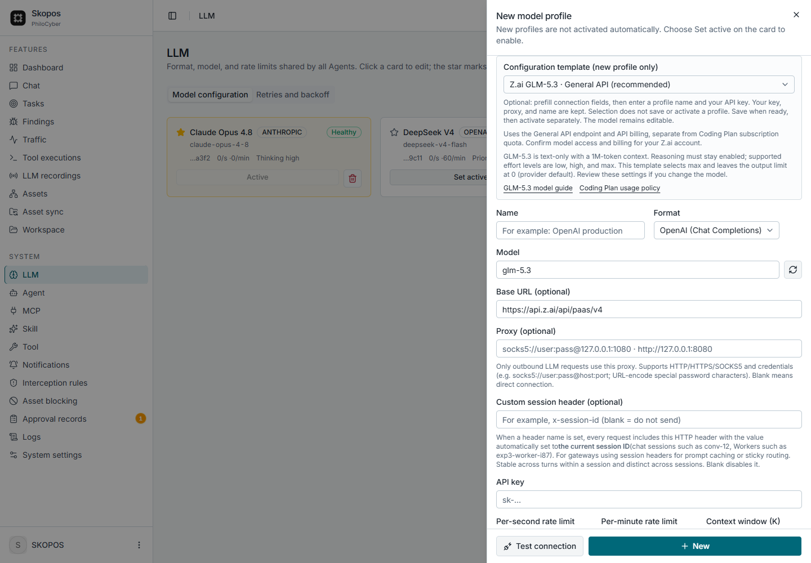

# LLM provider templates

Skopos uses its existing provider formats and custom base URL fields. A template only fills a **new profile's form**; it does not contact a provider, save credentials, activate a profile, or modify existing profiles.

## Z.ai GLM-5.3

Template preview with no API key entered; this is not a live provider connection.

Open **LLM → New → Configuration template**. Choose **General API (recommended)** for API billing, or **Coding Plan (reference)** only after obtaining Z.ai authorization for Skopos.

| Field | General API | Coding Plan reference |
| --- | --- | --- |
| Format | OpenAI Chat Completions | OpenAI Chat Completions |
| Base URL | `https://api.z.ai/api/paas/v4` | `https://api.z.ai/api/coding/paas/v4` |
| Model | `glm-5.3` | `glm-5.3` |
| Thinking | `enabled` | `enabled` |
| Reasoning effort | `max` | `max` |
| Context window (K) | `1000` | `1000` |
| Output limit | `0` (omit; provider default) | `0` (omit; provider default) |

The endpoints and billing are distinct: General API usage is separate from Coding Plan subscription quota. See [Z.ai connection configuration](https://zcode.z.ai/en/docs/configuration). Confirm your account's model access and billing before testing.

GLM-5.3 accepts text, has a 1M-token context window, and requires reasoning to remain enabled. Supported effort values are `low`, `high`, and `max`; this template uses `max`. The model field remains editable, so review reasoning and context settings when choosing another model. See the [official GLM-5.3 guide](https://docs.z.ai/guides/llm/glm-5.3).

**Coding Plan support boundary:** Z.ai limits Coding Plan to officially supported tools. Skopos is not on that list; an endpoint template does not establish permission or support. Obtain Z.ai authorization before using it here. See [tool integration](https://docs.z.ai/devpack/tool/others) and [usage policy](https://docs.z.ai/devpack/usage-policy). Skopos does not impersonate supported tools or switch billing endpoints automatically.

Enter a profile name and your own API key. Applying either template preserves any name, key, proxy, session-header setting, and other unrelated preferences already entered. Save when ready; a new profile must be activated separately. The existing **Test connection** and **Load models** controls make real provider requests only when clicked; this change does not perform a live provider test.

Verified against official documentation on **2026-10-03**. Provider availability, account entitlement, and policies may change.

## Gateways: one key, many models

Instead of one direct key per provider (Anthropic, OpenAI, DeepSeek, GLM, Qwen), a single gateway key can reach many models. Skopos needs no new provider format for this: both gateways expose the Anthropic Messages and OpenAI Chat Completions/Responses surfaces, so a profile only needs the right **Format**, **Base URL**, **model ID** and key. Open **LLM → New** and pick a **Provider** (Anthropic, OpenAI, Z.ai, Vercel AI Gateway or Amazon Bedrock): the first template for that provider fills the whole form at once, a second list switches between that provider's templates, Bedrock adds an **AWS Region** list that rewrites the Base URL, and a link opens the provider's page for creating the key. You then only paste the key. Direct provider keys keep working unchanged.

| Template | Format | Base URL | Example model | Load models |
| --- | --- | --- | --- | --- |
| Vercel AI Gateway, any model | OpenAI Chat Completions | `https://ai-gateway.vercel.sh/v1` | `anthropic/claude-sonnet-5` | Yes |
| Vercel AI Gateway, Claude | Anthropic | `https://ai-gateway.vercel.sh` | `anthropic/claude-sonnet-5` | Yes |
| Amazon Bedrock, Claude | Anthropic | `https://bedrock-runtime.us-east-1.amazonaws.com/anthropic` | `us.anthropic.claude-sonnet-5` | No (type the ID) |
| Amazon Bedrock, open models | OpenAI Chat Completions | `https://bedrock-mantle.us-east-1.api.aws/v1` | `openai.gpt-oss-120b` | Yes |

The templates leave thinking and effort unset and declare a conservative 200K context window, because support differs per model and gateways reject fields a model lacks. Set them for the model you pick. Like every template, selecting one only fills the form: nothing is saved, activated or contacted until you save and click **Test connection** or **Load models**.

### Vercel AI Gateway

1. In the Vercel dashboard open **AI Gateway → API keys → Create key** and copy it. This is an AI Gateway key, not a Vercel account token and not a provider key.
2. Choose a Vercel template, paste the key, click **Load models** and pick one. Model IDs are `provider/model`, for example `anthropic/claude-sonnet-5`.
3. Click **Test connection**, save, then **Set active**.

Use the **Anthropic** template for Claude models (native Messages API, so prompt caching passes through) and the **Chat Completions** template for everything else. For OpenAI models that need function calling, such as GPT-6.1 Sol, keep the Chat Completions Base URL and change **Format** to *OpenAI (Responses API)*; the gateway serves the Responses API on the same `/v1` URL.

The Anthropic Base URL has no path. Skopos appends `/v1/messages`, so a trailing `/v1` would become `/v1/v1/messages`.

### Amazon Bedrock API keys

1. In the Bedrock console open **API keys** and generate a key. **Short-term** keys last up to 12 hours and are recommended for production; **long-term** keys last until their expiry date and are meant for exploration. A long-term key works only in the Region it was generated in.
2. Choose a Bedrock template and replace `us-east-1` in the Base URL with the Region of the key.
3. Paste the key, pick a model, **Test connection**, save, **Set active**.

Two endpoints are used, both authenticated by the same key:

- **bedrock-runtime** (AWS's recommended endpoint): Claude through `/anthropic`, and OpenAI-compatible models through `/openai/v1`. It does not implement `GET /models`, so **Load models** explains this instead of failing. Type the model ID from the model's card in the Bedrock console. Claude and other cross-Region models need an inference profile ID such as `us.anthropic.claude-sonnet-5` or `global.anthropic.claude-sonnet-5`.
- **bedrock-mantle** (the "Bedrock open models" template): `/v1`, with **Load models** support. It serves DeepSeek, Qwen, GLM, Kimi, Mistral, gpt-oss and others. A few models are served under `/openai/v1` instead; if a request fails with *isn't supported on this route*, change the path.

Model access and IAM still apply. The principal behind the key needs `bedrock:CallWithBearerToken` plus `bedrock:InvokeModel` (runtime), or `bedrock-mantle:CallWithBearerToken` plus `bedrock-mantle:CreateInference` (mantle), and the model must be enabled for your account in that Region. Not every model is on both endpoints; check [endpoint availability](https://docs.aws.amazon.com/bedrock/latest/userguide/models-endpoint-availability.html).

### Built-in error guidance

The form warns, before you click anything, when a gateway Base URL has the wrong path for the chosen format, still contains a Region placeholder, or uses the wrong model ID style (a slash for Bedrock, no slash for Vercel). **Test connection** and **Load models** repeat these checks on the server and, when a request fails, append a one-line hint to the original error. Hints cover:

| Gateway | Failure | Hint |
| --- | --- | --- |
| Vercel | 401 | Use an AI Gateway API key from the dashboard |
| Vercel | 402 | Balance or budget exhausted; add credits |
| Vercel | 403 | Check key scope and whether the model needs a provider key (BYOK) |
| Vercel | 404 | Use `provider/model`; pick from Load models |
| Vercel | 429 | Lower the profile's request rate |
| Bedrock | `Credential should be scoped to a valid region` | The key's Region differs from the URL's Region |
| Bedrock | Expired token | Short-term keys last at most 12 hours |
| Bedrock | 401 | Paste the full Bedrock API key, not an AWS access key ID or secret |
| Bedrock | 403 / AccessDenied | IAM permissions or model access missing |
| Bedrock | On-demand throughput not supported | Use an inference profile ID (`us.` or `global.` prefix) |
| Bedrock | Model not supported on this route | Switch between `/v1` and `/openai/v1` on mantle |
| Bedrock | 404 / invalid model | Check path, Region and model ID |
| Bedrock | 429 | Per-model quota throttling; lower the rate or request an increase |

Custom and self-hosted endpoints are never validated or rewritten, and the original error is always kept.

Verified against official documentation on **2026-10-21**: [Vercel AI Gateway](https://vercel.com/docs/ai-gateway/authentication-and-byok), [Amazon Bedrock API keys](https://docs.aws.amazon.com/bedrock/latest/userguide/api-keys.html), [Bedrock endpoints](https://docs.aws.amazon.com/bedrock/latest/userguide/endpoints.html). Gateway model catalogues, prices and Regions change; confirm your account's access before relying on a template.
