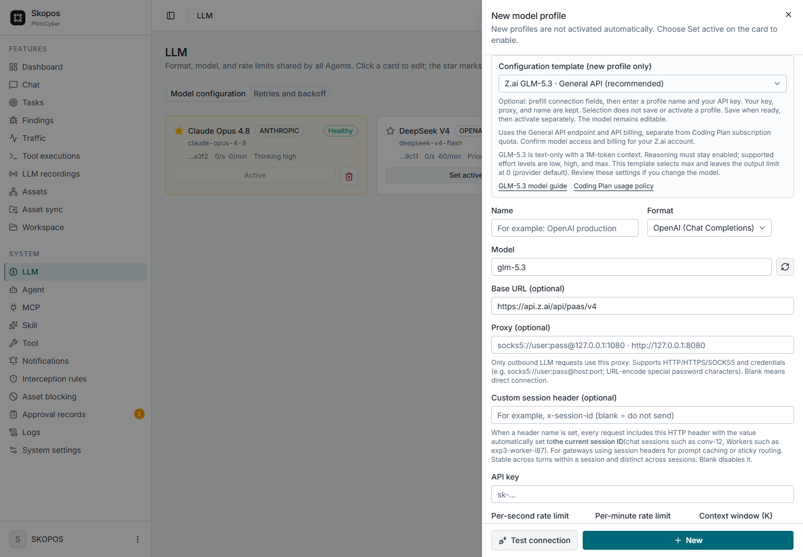

# LLM provider templates

Skopos uses its existing provider formats and custom base URL fields. A template only fills a **new profile's form**; it does not contact a provider, save credentials, activate a profile, or modify existing profiles.

## Z.ai GLM-5.3



Template preview with no API key entered; this is not a live provider connection.

Open **LLM → New → Configuration template**. Choose **General API (recommended)** for API billing, or **Coding Plan (reference)** only after obtaining Z.ai authorization for Skopos.

| Field | General API | Coding Plan reference |
| --- | --- | --- |
| Format | OpenAI Chat Completions | OpenAI Chat Completions |
| Base URL | `https://api.z.ai/api/paas/v4` | `https://api.z.ai/api/coding/paas/v4` |
| Model | `glm-5.3` | `glm-5.3` |
| Thinking | `enabled` | `enabled` |
| Reasoning effort | `max` | `max` |
| Context window (K) | `1000` | `1000` |
| Output limit | `0` (omit; provider default) | `0` (omit; provider default) |

The endpoints and billing are distinct: General API usage is separate from Coding Plan subscription quota. See [Z.ai connection configuration](https://zcode.z.ai/en/docs/configuration). Confirm your account's model access and billing before testing.

GLM-5.3 accepts text, has a 1M-token context window, and requires reasoning to remain enabled. Supported effort values are `low`, `high`, and `max`; this template uses `max`. The model field remains editable, so review reasoning and context settings when choosing another model. See the [official GLM-5.3 guide](https://docs.z.ai/guides/llm/glm-5.3).

**Coding Plan support boundary:** Z.ai limits Coding Plan to officially supported tools. Skopos is not on that list; an endpoint template does not establish permission or support. Obtain Z.ai authorization before using it here. See [tool integration](https://docs.z.ai/devpack/tool/others) and [usage policy](https://docs.z.ai/devpack/usage-policy). Skopos does not impersonate supported tools or switch billing endpoints automatically.

Enter a profile name and your own API key. Applying either template preserves any name, key, proxy, session-header setting, and other unrelated preferences already entered. Save when ready; a new profile must be activated separately. The existing **Test connection** and **Load models** controls make real provider requests only when clicked; this change does not perform a live provider test.

Verified against official documentation on **2026-10-03**. Provider availability, account entitlement, and policies may change.


## Gateways: one key, many models

Instead of one direct key per provider (Anthropic, OpenAI, DeepSeek, GLM, Qwen), a single gateway key can reach many models. Skopos needs no new provider format for this: both gateways expose the Anthropic Messages and OpenAI Chat Completions/Responses surfaces, so a profile only needs the right **Format**, **Base URL**, **model ID** and key. Open **LLM → New** and pick a **Provider** (Anthropic, OpenAI, Z.ai, Vercel AI Gateway or Amazon Bedrock): the first template for that provider fills the whole form at once, a second list switches between that provider's templates, Bedrock adds an **AWS Region** list that rewrites the Base URL, and a link opens the provider's page for creating the key. You then only paste the key. Direct provider keys keep working unchanged.

| Template | Format | Base URL | Example model | Load models |
| --- | --- | --- | --- | --- |
| Vercel AI Gateway, any model | OpenAI Chat Completions | `https://ai-gateway.vercel.sh/v1` | `anthropic/claude-sonnet-5` | Yes |
| Vercel AI Gateway, Claude | Anthropic | `https://ai-gateway.vercel.sh` | `anthropic/claude-sonnet-5` | Yes |
| Amazon Bedrock, Claude | Anthropic | `https://bedrock-runtime.us-east-1.amazonaws.com/anthropic` | `us.anthropic.claude-sonnet-5` | No (type the ID) |
| Amazon Bedrock, open models | OpenAI Chat Completions | `https://bedrock-mantle.us-east-1.api.aws/v1` | `openai.gpt-oss-120b` | Yes |

The templates leave thinking and effort unset and declare a conservative 200K context window, because support differs per model and gateways reject fields a model lacks. Set them for the model you pick. Like every template, selecting one only fills the form: nothing is saved, activated or contacted until you save and click **Test connection** or **Load models**.

### Vercel AI Gateway

1. In the Vercel dashboard open **AI Gateway → API keys → Create key** and copy it. This is an AI Gateway key, not a Vercel account token and not a provider key.
2. Choose a Vercel template, paste the key, click **Load models** and pick one. Model IDs are `provider/model`, for example `anthropic/claude-sonnet-5`.
3. Click **Test connection**, save, then **Set active**.

Use the **Anthropic** template for Claude models (native Messages API, so prompt caching passes through) and the **Chat Completions** template for everything else. For OpenAI models that need function calling, such as GPT-6.1 Sol, keep the Chat Completions Base URL and change **Format** to *OpenAI (Responses API)*; the gateway serves the Responses API on the same `/v1` URL.

The Anthropic Base URL has no path. Skopos appends `/v1/messages`, so a trailing `/v1` would become `/v1/v1/messages`.

### Amazon Bedrock API keys

1. In the Bedrock console open **API keys** and generate a key. **Short-term** keys last up to 12 hours and are recommended for production; **long-term** keys last until their expiry date and are meant for exploration. A long-term key works only in the Region it was generated in.
2. Choose a Bedrock template and replace `us-east-1` in the Base URL with the Region of the key.
3. Paste the key, pick a model, **Test connection**, save, **Set active**.

Two endpoints are used, both authenticated by the same key:

- **bedrock-runtime** (AWS's recommended endpoint): Claude through `/anthropic`, and OpenAI-compatible models through `/openai/v1`. It does not implement `GET /models`, so **Load models** explains this instead of failing. Type the model ID from the model's card in the Bedrock console. Claude and other cross-Region models need an inference profile ID such as `us.anthropic.claude-sonnet-5` or `global.anthropic.claude-sonnet-5`.
- **bedrock-mantle** (the "Bedrock open models" template): `/v1`, with **Load models** support. It serves DeepSeek, Qwen, GLM, Kimi, Mistral, gpt-oss and others. A few models are served under `/openai/v1` instead; if a request fails with *isn't supported on this route*, change the path.

Model access and IAM still apply. The principal behind the key needs `bedrock:CallWithBearerToken` plus `bedrock:InvokeModel` (runtime), or `bedrock-mantle:CallWithBearerToken` plus `bedrock-mantle:CreateInference` (mantle), and the model must be enabled for your account in that Region. Not every model is on both endpoints; check [endpoint availability](https://docs.aws.amazon.com/bedrock/latest/userguide/models-endpoint-availability.html).

### Built-in error guidance

The form warns, before you click anything, when a gateway Base URL has the wrong path for the chosen format, still contains a Region placeholder, or uses the wrong model ID style (a slash for Bedrock, no slash for Vercel). **Test connection** and **Load models** repeat these checks on the server and, when a request fails, append a one-line hint to the original error. Hints cover:

| Gateway | Failure | Hint |
| --- | --- | --- |
| Vercel | 401 | Use an AI Gateway API key from the dashboard |
| Vercel | 402 | Balance or budget exhausted; add credits |
| Vercel | 403 | Check key scope and whether the model needs a provider key (BYOK) |
| Vercel | 404 | Use `provider/model`; pick from Load models |
| Vercel | 429 | Lower the profile's request rate |
| Bedrock | `Credential should be scoped to a valid region` | The key's Region differs from the URL's Region |
| Bedrock | Expired token | Short-term keys last at most 12 hours |
| Bedrock | 401 | Paste the full Bedrock API key, not an AWS access key ID or secret |
| Bedrock | 403 / AccessDenied | IAM permissions or model access missing |
| Bedrock | On-demand throughput not supported | Use an inference profile ID (`us.` or `global.` prefix) |
| Bedrock | Model not supported on this route | Switch between `/v1` and `/openai/v1` on mantle |
| Bedrock | 404 / invalid model | Check path, Region and model ID |
| Bedrock | 429 | Per-model quota throttling; lower the rate or request an increase |

Custom and self-hosted endpoints are never validated or rewritten, and the original error is always kept.

Verified against official documentation on **2026-10-21**: [Vercel AI Gateway](https://vercel.com/docs/ai-gateway/authentication-and-byok), [Amazon Bedrock API keys](https://docs.aws.amazon.com/bedrock/latest/userguide/api-keys.html), [Bedrock endpoints](https://docs.aws.amazon.com/bedrock/latest/userguide/endpoints.html). Gateway model catalogues, prices and Regions change; confirm your account's access before relying on a template.

## Self-hosted vLLM on RunPod

For the complete deployment sequence, API checks, approvals, troubleshooting and optional adapter setup, see [RunPod setup for Skopos](../README.md#runpod-setup-for-skopos). The same guide is available in **Documentation → RunPod setup**.

Skopos and CyberStrike talk to this same server as a normal OpenAI Chat Completions endpoint. `VLLM_API_KEY` authenticates the server, not one application: both clients send that bearer token to the same base URL. Skopos selects the base model. CyberStrike selects the adapter id, and only after that adapter is loaded.

This is the pod that served `Qwen/Qwen3.6-35B-A3B` at a 131,072-token context. Image `vllm/vllm-openai:v0.30.0`, HTTP port **8000**, one H200 SXM on Secure Cloud, and a network volume mounted at `/workspace`. The image entrypoint is already `vllm serve`, so the RunPod container start command is arguments only. Do not prefix `vllm serve` or a shell.

```text
--model Qwen/Qwen3.6-35B-A3B --quantization fp8 --enable-lora --max-lora-rank 32 --host 0.0.0.0 --port 8000 --max-model-len 131072 --gpu-memory-utilization 0.90 --enable-prefix-caching --enable-auto-tool-choice --tool-call-parser qwen3_xml
```

Environment on the pod:

| Variable | Value |
| --- | --- |
| `HF_HOME` | `/workspace/hf_cache` |
| `HF_HUB_ENABLE_HF_TRANSFER` | `1` |
| `VLLM_API_KEY` | a key you choose |
| `VLLM_ALLOW_RUNTIME_LORA_UPDATING` | `1` |

`HF_HOME` on the network volume keeps the weights after a stop. The container disk does not, so the next boot recompiles CUDA graphs. `--max-model-len 131072` is the whole context window (prompt plus reply), not an output cap. The checkpoint allows 262144. A 32,768 window is too small for this agent: the tool-bearing prompt is already about 29,000 tokens, and vLLM rejects the call when prompt plus `max_tokens` exceeds the window. `--enable-lora` is on so another client can attach an adapter later. Do not add `--lora-modules` with a Hub repo and an `@revision`. vLLM 0.30 passes that string through as a repo id, the `@` is rejected, and the server exits after the base model has loaded.

Once port 8000 is Ready, the base URL is `https://<pod-id>-8000.proxy.runpod.net/v1`. A migration creates a new pod id. Update the profile. An empty HTTP 404 from that host means that pod id is not serving the port.

In Skopos open **LLM → New** and save this profile, then **Set active**. Use Chat Completions. The Responses API template does not match this server.

| Field | Value |
| --- | --- |
| Format | OpenAI (Chat Completions) |
| Model | `Qwen/Qwen3.6-35B-A3B` |
| Base URL | `https://<pod-id>-8000.proxy.runpod.net/v1` |
| API key | the same value as `VLLM_API_KEY` |
| Context window (K) | `96` |
| Output limit | `8192` |
| Proxy, thinking, reasoning effort | leave unset |

Context window (K) is only Skopos's local compaction budget. Output limit is what the request sends as `max_tokens`. Leave that at `0` and Skopos omits the field. vLLM then asks for the whole `--max-model-len` as output, the prompt no longer fits, and the call fails with 400. An unset or smaller Context window (K) is raised to 32, which is not enough once tools are attached: that prompt is already about 29,000 tokens, so `8192` of output overflows a 32,768 window and compaction cannot delete the tool definitions. `96` keeps the local budget under `131072 - 8192`.

### CyberStrike on the same pod

Use the same base URL and the same API key. Change only the model id.

| Client | Model |
| --- | --- |
| Skopos | `Qwen/Qwen3.6-35B-A3B` |
| CyberStrike | `cyberstrike-offsec` |

`GET /v1/models` lists `cyberstrike-offsec` only after the adapter is loaded. The key is already valid before that. A request that names the adapter id early returns 404.

The adapter is the Hugging Face branch `adapter` of `oyildirim/CyberStrike-OffSec-35B`, not the merged weights on `main`. Download that revision onto the volume, for example `/workspace/hf_cache/cyberstrike-offsec`, and confirm `adapter_config.json` is there. Then POST `/v1/load_lora_adapter`:

```json
{"lora_name":"cyberstrike-offsec","lora_path":"/workspace/hf_cache/cyberstrike-offsec"}
```

If that POST is refused, stop the pod, add `--lora-modules cyberstrike-offsec=/workspace/hf_cache/cyberstrike-offsec` to the start command, and start once. That value is a directory on the volume. Do not pass `repo@revision`. Skopos stays on the base model id.


## Codex / ChatGPT subscription

In **System > LLM**, click **Connect Codex**, then **Continue with ChatGPT**. Complete the native Codex browser sign-in, select a model, test, and save the profile. Activate it or bind it to an agent or task as usual. This replaces the earlier open-source subscription-sharing flow. Enterprise workspaces use their Codex permissions and approval settings.

Install the Codex CLI on the backend host (`codex` on PATH), or set `SKOPOS_CODEX_BINARY` to its executable. Skopos uses `codex app-server --listen stdio://`, identifies itself as `skopos`, and enables the experimental protocol for dynamic tools and history injection. The connector was checked against CLI 0.156.1. New Enterprise clients may need registration with OpenAI, as described in the [app-server documentation](https://learn.chatgpt.com/docs/app-server). Workspace access is ultimately checked by OpenAI.

Use a browser on the backend computer for its native loopback callback. A remote backend or container requires an appropriate loopback tunnel. Cancel the pending sign-in before starting another; attempts expire after five minutes.

Skopos creates a private Codex home for each saved connection under `chatgpt-subscription/native-codex/<connection-id>/` beside its JWT key. Codex owns OAuth, refresh, and workspace routing. Credentials are never returned to the UI. The connector does not import the user's desktop/CLI login, configuration, skills, hooks, or API keys. Old subscription-sharing credentials remain untouched but are no longer used. Reconnect old profiles with **Continue with ChatGPT**. Run one Skopos backend per credential directory.

Models come from native `model/list`, preserving names and ordering. The catalog may be cached and does not guarantee account entitlement; use **Test connection** to verify inference. Daybreak uses advertised `availableAccessPrograms.cyber` values. Models without an advertised Daybreak program are disabled when the switch is on. The selected program is saved per profile and explicitly sent on every turn. OpenAI still validates workspace and model approval; missing access is reported as an error without falling back silently.

Inference uses ephemeral native threads, host instructions, and the supplied conversation history. Dynamic tool requests return to Skopos for its normal permission checks and execution, and tool results are replayed on the next request. Codex shell, apps, hooks, web search, and delegation are disabled. Unexpected native tool requests fail the request. Codex controls token refresh, transport, reasoning implementation, and output limits; the profile uses its reasoning-effort setting but clears incompatible HTTP proxy, session-header, thinking-type and output-cap overrides. Native runtime calls are serialized per connection to prevent concurrent credential refreshes. Token usage is recorded when Codex reports it; a tool handoff may precede the native usage event.

Deleting a profile does not remove its shared connection. Native credentials and account access remain subject to the Codex and ChatGPT workspace controls.

References: [native Codex authentication](https://learn.chatgpt.com/docs/auth), [Codex app-server](https://learn.chatgpt.com/docs/app-server).
